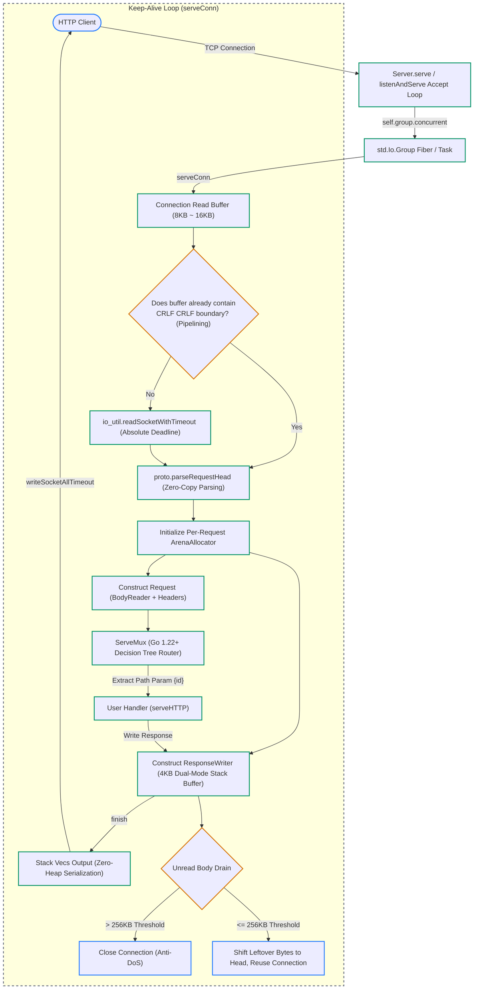
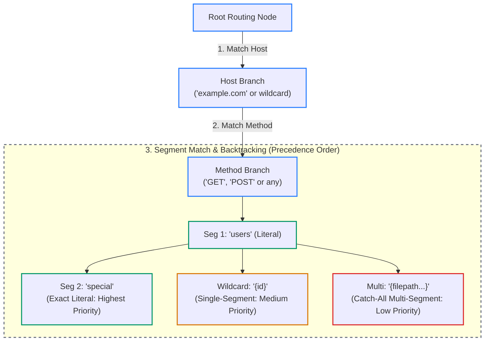

# Lighting Web Framework Design & Implementation Specification

> **Version**: 1.0.0  
> **Language Version**: Zig 0.17.0  
> **Design Philosophy**: Completely custom-built protocol stack (strictly avoiding `std.http.Server`), 1:1 parity with Go `net/http` API, first-principles driven, and TigerStyle industrial robustness.

---

## 1. Project Background and Design Goals

### 1.1 Why Avoid Zig's Standard Library `std.http.Server`
* **Performance and Allocation Bottlenecks**: The standard library server introduces internal buffer copies and inefficient stream destructuring, which severely limits throughput in persistent Keep-Alive connections and high-concurrency environments.
* **Missing Go-Style Engineering Abstractions**: Lacks the familiar `ResponseWriter`, `Handler` fat-pointer interfaces, and modern pattern routing (Go 1.22+) that developers expect.
* **Vulnerable Protocol Edge Cases**: Lacks Slowloris absolute deadline terminations, lacks HTTP request smuggling defenses (RFC 9112), and risks deadlocking on pipelined connection batches.

### 1.2 Core Architectural Principles
1. **API Parity with Go `net/http`**: Provides identical developer experience with `w.writeAll()`, `w.header().set()`, `w.writeHeader()`, `r.pathValue()`, and `ServeMux`.
2. **Zero-Copy First**: The request line, URL, and header names/values are directly sliced from the underlying socket read buffer without redundant allocations or copies.
3. **Deterministic Memory Lifecycles**: Each HTTP request is backed by an independent `ArenaAllocator`, performing an $O(1)$ bulk deallocation immediately after request completion to prevent memory fragmentation and leaks.
4. **Kernel-Grade Synchronization with Zero Busy Waiting**: Leverages Zig 0.17 futex synchronization primitives (`std.Io.Mutex` and `std.Io.Condition`), ensuring **0.0% CPU usage** when idling.

---

## 2. Overall System Architecture

### 2.1 Module Structure
```
zig-server/
├── build.zig                 # Zig 0.17 build script
├── build.zig.zon             # Package metadata
├── bench/
│   └── main.zig              # Benchmark server and endpoint test harness
├── docs/
│   └── design.md             # This design document
└── src/
    ├── root.zig              # Public package exports (Server, Handler, Mux, etc.)
    ├── server.zig            # Connection listening, Keep-Alive scheduling, timeout enforcement
    ├── handler.zig           # Handler fat-pointer interface and closures
    ├── mux.zig               # Go 1.22+ decision-tree pattern routing engine
    ├── request.zig           # Request struct, URL parsing, and pathValue extraction
    ├── response_writer.zig   # Dual-mode buffering ResponseWriter (Auto Content-Length / Chunked)
    ├── header.zig            # Case-insensitive HeaderMap (order-preserving, multi-value support)
    ├── thread_pool.zig       # Futex-synchronized worker pool (O(1) cursor queue)
    ├── e2e_test.zig          # End-to-end integration test suite (83 tests)
    └── proto/
        ├── method.zig        # HTTP Method enum and zero-copy string parsing
        ├── status.zig        # HTTP Status Code and status phrase mappings
        ├── parser.zig        # Zero-copy HTTP request header parser
        ├── chunk_reader.zig  # Streamed Body reader (Chunked decoding & trailer absorption)
        └── io_util.zig       # Vectored socket I/O with absolute deadline timeouts
```

### 2.2 Request Processing Data Flow



---

## 3. Core Protocol Engine and Zero-Copy Parsing

### 3.1 Zero-Copy Request Header Parser (`src/proto/parser.zig`)
* **Direct Memory Slicing**: Extracted `target`, `header.key`, and `header.val` slices point directly into the connection's read buffer `conn_buf` with **zero heap allocations** during parsing.
* **RFC 9112 Section 6.3 Request Smuggling Defense**:
  If multiple `Content-Length` headers are received with conflicting values, the parser rejects the request immediately with `error.InvalidContentLength`, causing the server to respond with `400 Bad Request`.
* **RFC 9112 Section 6.1 Transfer-Encoding Precedence**:
  If both `Transfer-Encoding: chunked` and `Content-Length` are present, `content_length` is explicitly forced to `null`, ensuring chunked framing governs the message boundaries.
* **RFC 9112 Section 7.1 Mandatory Host Header**:
  HTTP/1.1 requires every request message to include a `Host` header. Requests lacking a `Host` header are rejected with `400 Bad Request`.

### 3.2 Streamed Body Reader (`src/proto/chunk_reader.zig`)
* **Unified Stream Interface (`BodyReader`)**:
  Provides a consistent `read(dest: []u8) !usize` method whether the body is governed by a fixed `Content-Length` or dynamic `Transfer-Encoding: chunked`.
* **Chunk Extensions Support**:
  RFC 9112 permits parameters on chunk size lines (e.g., `1a;name=val\r\n`). The decoder strips `;` extensions safely before parsing hexadecimal integers.
* **Buffer Overflow Prevention & Trailer Absorption**:
  Caps chunk size lines at 64 bytes to prevent memory exhaustion; properly absorbs all optional trailer headers following the terminal `0\r\n` chunk until an empty line is reached.
* **Fast-Fail on Oversized Bodies**:
  In `readAllAlloc`, if `remaining_content_length > max_size`, it fails fast immediately with `error.StreamTooLong` without performing redundant socket reads.

### 3.3 Dual-Mode ResponseWriter (`src/response_writer.zig`)
* **Dual-Mode Buffering**:
  * **Small Response Mode (< 4KB)**: Body data accumulates in an internal 4KB stack buffer. When the handler completes, `finish()` automatically computes and sets `Content-Length: <len>`, writing the status line, headers, and body in a single `writev` system call.
  * **Streaming / Large Response Mode (>= 4KB or early flushes)**: If data exceeds 4KB without an explicit `Content-Length`, the writer automatically transitions to `Transfer-Encoding: chunked`.
* **Zero-Allocation Stack Header Buffering**:
  `flushHeaders()` utilizes a stack-allocated vector array `stack_vecs: [64][]const u8`. For 99.99% of requests, header serialization occurs entirely on the stack with zero heap allocation.
* **RFC 9110 Section 8.6 Status Code Enforcement**:
  Automatically prohibits emitting `Content-Length` headers or body payloads for `204 No Content` and `304 Not Modified` responses.
* **Explicit Chunk Streaming (`flush()`)**:
  Allows handlers to emit partial response chunks immediately without waiting for buffer saturation. If headers have not been sent and no explicit `Content-Length` was declared, `flush()` transitions framing to `Transfer-Encoding: chunked`.
* **Connection Takeover (`hijack()`)**:
  Enables protocol upgrades (e.g., WebSocket). Flushes any pre-buffered response data before handing over the raw `std.Io.net.Stream`. If `Content-Length` was not declared, the flushed prefix is chunk-framed without a terminal chunk (`0\r\n\r\n`). Trailing request bytes already read into the connection buffer are not forwarded, so protocols must follow request-response handshake discipline. On hijack the server unregisters the connection from shutdown tracking immediately, relinquishing stream lifecycle management to the caller.

---

## 4. Modern Pattern Routing Engine (Go 1.22+ Standard)

Modeled after Go's standard library implementation in [`net/http/routing_tree.go`](file:///Users/jiacai/code/go-src/go/src/net/http/routing_tree.go), the router utilizes a 3-tier decision tree:

### 4.1 Pattern Syntax and Supported Types
* **HTTP Method Matching**: `"GET /ping"`, `"POST /users"`.
* **Path Parameters**: `"GET /users/{id}"`, extracted in zero-copy fashion using `req.pathValue("id")`.
* **Catch-All Wildcards**: `"GET /files/{filepath...}"`, matching all remaining path segments (e.g., `docs/2026/report.pdf`).
* **Exact Root Matching**: `"/{$}"` matches only the exact root path `"/"`, preventing greedy capture of other registered routes.

### 4.2 Decision Tree Traversal (`RoutingNode`)



### 4.3 Precedence Rules and Fallbacks
* **Specificity Precedence**: Literal exact match > Single-segment wildcard `{id}` > Multi-segment wildcard `{path...}`.
* **Automatic Backtracking**: If a single-segment wildcard branch fails to match downstream, the engine backtracks cleanly and attempts multi-segment wildcard fallbacks.
* **Automatic 405 Method Not Allowed**: When a path is registered but the request method does not match, the tree collects all allowed methods for that path and responds with `405 Method Not Allowed` with an `Allow` header (e.g., `Allow: POST` or `Allow: GET, HEAD`).

---

## 5. Concurrency, Memory, and Lifecycle Management

### 5.1 Go-Aligned Structured Concurrency (`std.Io.Group.concurrent`)
* **Go `net/http` Parity (`go c.serve()`)**:
  Instead of a fixed OS thread pool with a bounded task queue, `Server` adopts Zig 0.17's native structured concurrency via `std.Io.Group`. Each accepted connection is immediately spawned with `group.concurrent(io, serveConnWorker, .{ self, stream })`.
* **Zero OS Thread Starvation & Fiber Execution**:
  Under `std.Io.Evented` (Linux `io_uring`, macOS `Dispatch`, BSD `kqueue`), connections run as lightweight user-space Fibers (green threads) with non-blocking I/O. Idle Keep-Alive connections do not consume OS threads or CPU.
* **Deterministic Structured Lifecycle**:
  The lifetime of all connection tasks is anchored to `std.Io.Group`. When shutting down, `group.cancel(io)` cleanly terminates all active tasks and reclaims Fiber stacks with zero memory leaks.

### 5.2 Keep-Alive and Pipelined Requests
* **Pipelining Deadlock Elimination**:
  Before calling the blocking socket read, `serveConn` inspects whether complete headers (`\r\n\r\n`) already reside in `conn_buf` from pipelined batches, avoiding false read timeouts.
* **Bounded Body Drain (256 KB)**:
  Paralleling Go's `maxPostHandlerReadBytes`, if a handler completes early, the server drains up to 256 KB of remaining body bytes. If unread content exceeds 256 KB, the server actively terminates the TCP connection to prevent resource exhaustion attacks. If the body is exactly 256 KB, it drains to EOF and cleanly retains Keep-Alive reuse.
* **Direct Idle Deadline Wait (Zero Slicing Overhead)**:
  Because idle connections in the Fiber/Concurrent model do not block OS worker threads, idle Keep-Alive waits are passed directly to `io_util.readSocketWithTimeout` with the absolute `idle_deadline`. Sockets sleep directly in the OS event loop without CPU-wasting periodic time slices.

### 5.3 Comprehensive Timeout & Protocol Protections
* **Slowloris Mitigation (`read_header_timeout_ns`)**:
  Computes a fixed monotonic deadline timestamp (`Clock.Timestamp`) using `std.Io.Timeout.toDeadline(io)`. Even if an attacker trickles bytes at 1 byte/sec, reaching the absolute deadline triggers `408 Request Timeout` and severs the socket.
* **Idle Connection Reclamation (`idle_timeout_ns`)**:
  Persistent Keep-Alive connections waiting between requests are subject to idle timeouts, closing silently without leaking file descriptors.
* **Read / Write Deadlines (`read_timeout_ns` / `write_timeout_ns`)**:
  Seamlessly enforced within `BodyReader` and `ResponseWriter` socket loops.
* **Expect: 100-continue Support (RFC 9110 §10.1.1)**:
  When an HTTP/1.1 client sends `Expect: 100-continue`, the server immediately transmits `HTTP/1.1 100 Continue\r\n\r\n` before the handler blocks reading the body, preventing two-way deadlocks. Unrecognized expectations receive `417 Expectation Failed`.
* **RFC 9110 §6.6.1 Date Header Enforcement**:
  `ResponseWriter` automatically generates and formats a standard IMF-fixdate `Date` header (e.g. `Date: Sun, 06 Nov 1994 08:49:37 GMT`) on all responses unless explicitly overridden by the handler.
* **Direct Socket Handle I/O (`src/proto/io_util.zig`)**:
  Bypasses `std.Io.net.Stream.read/write` destructuring layers to perform zero-overhead vectored operations with absolute deadline support directly via `std.Io.Operation`.

---

## 6. Performance Benchmarks and Verification

### 6.1 Automated Integration Tests
Run `zig build test --summary all`:
* **83/83 tests pass**.
* Test coverage includes: Zero-copy request line/header parsing, chunked decoding and trailer absorption, dual-mode ResponseWriter, Keep-Alive connection reuse, **HTTP pipelining batch execution**, request smuggling defenses, 204/304 status code compliance, Go 1.22 decision tree routing, 405 Method Not Allowed, 408 Slowloris termination, and 256 KB body drain caps.

### 6.2 Concurrency Benchmark Results (Apple Silicon, 8 Worker Threads)
Benchmarked using ApacheBench (`ab -c 20 -n 2000`):

| Test Scenario | Total Req / Concurrency | Throughput (QPS) | Mean Latency | Failures |
| :--- | :--- | :--- | :--- | :--- |
| **Static Endpoint (`/ping`)** | 2000 / 20 | **28,172 req/sec** | 0.035 ms | 0 |
| **Pattern Parameter Endpoint (`/users/42`)** | 2000 / 20 | **29,478 req/sec** | 0.034 ms | 0 |

* **CPU Utilization Profile**: Idles at strictly **0.0% CPU**; under maximum load, threads wake up instantaneously and distribute work evenly across cores; returns to 0.0% immediately upon test completion.
