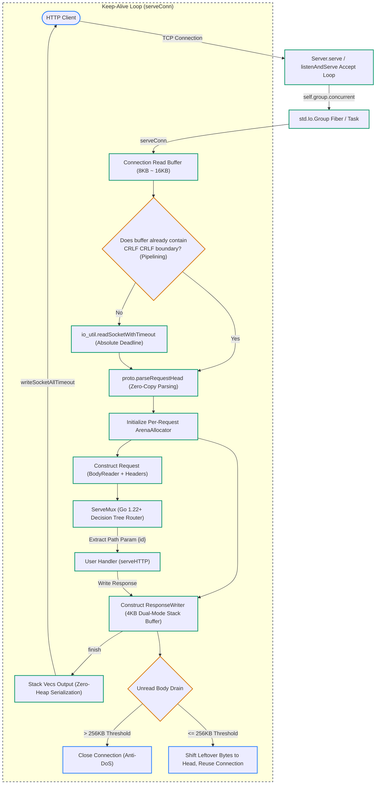

# System Architecture & I/O Flow

Lighting is engineered from first principles as an embedded, zero-dependency HTTP/1.1 engine. This chapter details the lifecycle of a TCP connection and the end-to-end data flow through the system.

---

## High-Level Request Pipeline

---

## Lifecycle Stages

### 1. Connection Accept Loop
* The listening socket is polled asynchronously within the main fiber.
* Upon receiving a client handshake, a new TCP stream is accepted.
* The stream is passed to `group.concurrent(io, serveConnWorker, .{ self, stream })`.

### 2. Keep-Alive Loop (`serveConn`)
* An 8KB–16KB buffer (`conn_buf`) is allocated for the connection.
* **Pipelining Check**: Before executing a socket read syscall, the server checks if leftover bytes from a previous pipelined request already contain the HTTP header boundary `\r\n\r\n`. If so, socket I/O is bypassed.
* **Zero-Copy Parsing**: `parseRequestHead` validates HTTP framing and slices headers in place without allocating heap memory.

### 3. Per-Request Scoping
* A dedicated `std.heap.ArenaAllocator` is initialized for the request.
* Temporary strings, route path-value maps, and body reader buffers reside inside this arena.
* The user handler runs to completion.

### 4. Zero-Heap Response Serialization
* If the response is $\le 4\text{KB}$, it is formatted entirely inside the stack buffer of `ResponseWriter`.
* Status line, response headers, and body are dispatched in a single vectored write (`writev`).

### 5. Residual Body Draining & Recycling
* If the client uploaded an unread body $\le 256\text{KB}$, the server automatically drains residual bytes to keep the socket synchronized.
* Any unread pipelined bytes are shifted to the front of `conn_buf` using `std.mem.copyForwards`.
* The arena is reset, and the connection waits for the next request.
