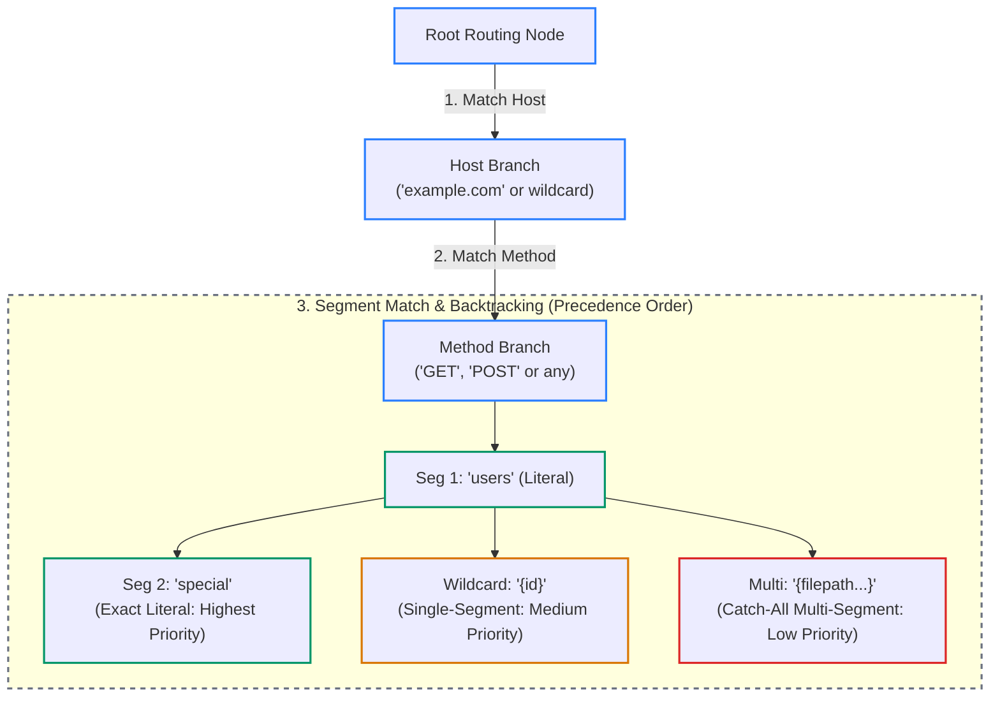

# Routing Tree Algorithm

The router in `src/mux.zig` implements a decision tree inspired by Go 1.22's router enhancements, supporting prefix trees, single-segment wildcards, multi-segment catch-alls, and method dispatch.

---

## 1. Decision Tree Traversal (`RoutingNode`)

---

## 2. Segment Matching Order

Routing nodes prioritize child matches using deterministic specificity:

1. **Exact Literal Segment**:
   * Evaluates literal strings directly (e.g., `"users"`).
   * O(1) string equality check against incoming segment.
2. **Single-Segment Wildcard (`{name}`)**:
   * Matches any single segment between two slashes.
   * Extracted key-value pair is stored into `req.path_values`.
3. **Multi-Segment Catch-All (`{path...}`)**:
   * Captures all remaining path segments including slashes.
   * Lowest priority in a branch; acts as fallback.

---

## 3. Backtracking Resolution

If an exact literal match branch fails downstream (for instance, `/users/admin/settings` when only `/users/{id}` is registered), the routing engine backtracks cleanly to wildcard and multi-segment candidate nodes instead of prematurely returning `404 Not Found`.

---

## 4. Automatic 405 Method Collection

When a request matches a registered URL path but the requested HTTP method differs:
1. `ServeMux` walks all sibling method branches for the resolved path.
2. It aggregates all valid methods (e.g., `GET`, `HEAD`, `POST`).
3. It sets the standard `Allow` header and returns `405 Method Not Allowed`.
